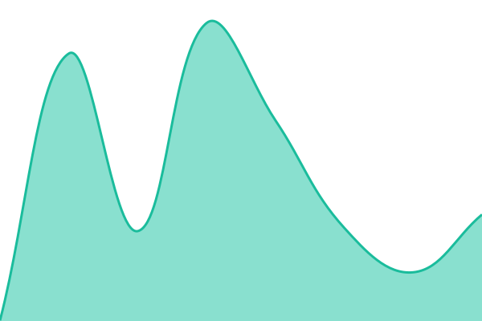
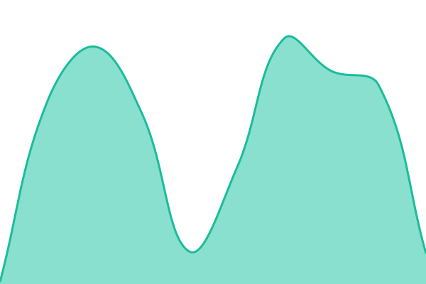
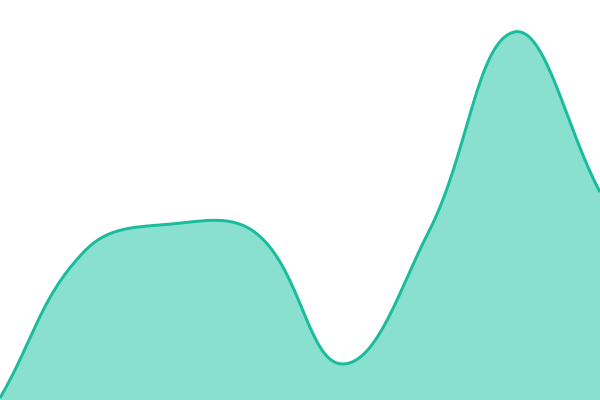
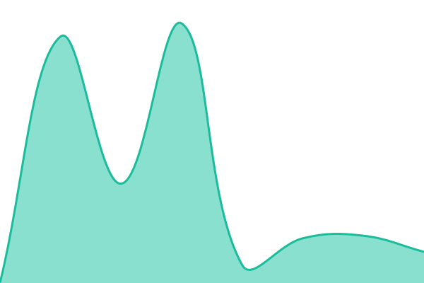
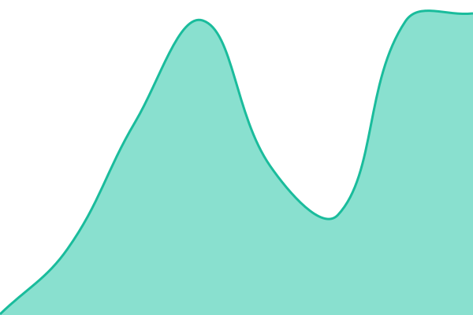
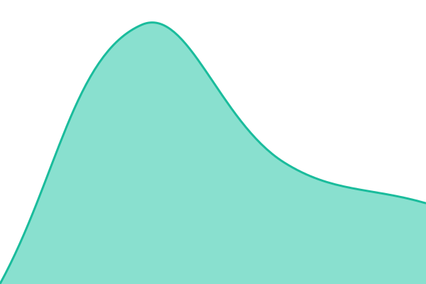

# [📈 Live Status](https://voidrendersystems.github.io/materium-status): <!--live status--> **🟩 All systems operational**

This repository contains the open-source uptime monitor and status page for [Voidrender Systems](https://voidrender.systems), powered by [Upptime](https://github.com/upptime/upptime).

With [Upptime](https://upptime.js.org), you can get your own unlimited and free uptime monitor and status page, powered entirely by a GitHub repository. We use [Issues](https://github.com/voidrendersystems/materium-status/issues) as incident reports, [Actions](https://github.com/voidrendersystems/materium-status/actions) as uptime monitors, and [Pages](https://voidrendersystems.github.io/materium-status) for the status page.

<!--start: status pages-->
<!-- This summary is generated by Upptime (https://github.com/upptime/upptime) -->
<!-- Do not edit this manually, your changes will be overwritten -->
<!-- prettier-ignore -->
| URL | Status | History | Response Time | Uptime |
| --- | ------ | ------- | ------------- | ------ |
|  [Website](https://materium.gg) | 🟩 Up | [website.yml](https://github.com/voidrendersystems/materium-status/commits/HEAD/history/website.yml) | 

 352ms
     
 | 

<a href="https://status.materium.gg/history/website">100.00%</a>
    

|  [Web Health](https://materium.gg/api/health) | 🟩 Up | [web-health.yml](https://github.com/voidrendersystems/materium-status/commits/HEAD/history/web-health.yml) | 

 193ms
     
 | 

<a href="https://status.materium.gg/history/web-health">100.00%</a>
    

|  [API Health](https://materium.gg/healthz) | 🟩 Up | [api-health.yml](https://github.com/voidrendersystems/materium-status/commits/HEAD/history/api-health.yml) | 

 78ms
     
 | 

<a href="https://status.materium.gg/history/api-health">100.00%</a>
    

|  [GraphQL API](https://materium.gg/graphql) | 🟩 Up | [graph-ql-api.yml](https://github.com/voidrendersystems/materium-status/commits/HEAD/history/graph-ql-api.yml) | 

 83ms
     
 | 

<a href="https://status.materium.gg/history/graph-ql-api">100.00%</a>
    

|  [Games Catalog](https://materium.gg/games) | 🟩 Up | [games-catalog.yml](https://github.com/voidrendersystems/materium-status/commits/HEAD/history/games-catalog.yml) | 

 610ms
     
 | 

<a href="https://status.materium.gg/history/games-catalog">100.00%</a>
    

|  [www Redirect](https://www.materium.gg) | 🟩 Up | [www-redirect.yml](https://github.com/voidrendersystems/materium-status/commits/HEAD/history/www-redirect.yml) | 

 551ms
     
 | 

<a href="https://status.materium.gg/history/www-redirect">100.00%</a>
    

|  [mychronicle.games Redirect](https://mychronicle.games) | 🟩 Up | [mychronicle-games-redirect.yml](https://github.com/voidrendersystems/materium-status/commits/HEAD/history/mychronicle-games-redirect.yml) | 

 623ms
     
 | 

<a href="https://status.materium.gg/history/mychronicle-games-redirect">100.00%</a>
    

<!--end: status pages-->

[**Visit our status website →**](https://voidrendersystems.github.io/materium-status)

## 📄 License

- Powered by: [Upptime](https://github.com/upptime/upptime)
- Code: [MIT](./LICENSE) © [Anand Chowdhary](https://anandchowdhary.com)
- Data in the `./history` directory: [Open Database License](https://opendatacommons.org/licenses/odbl/1-0/)
